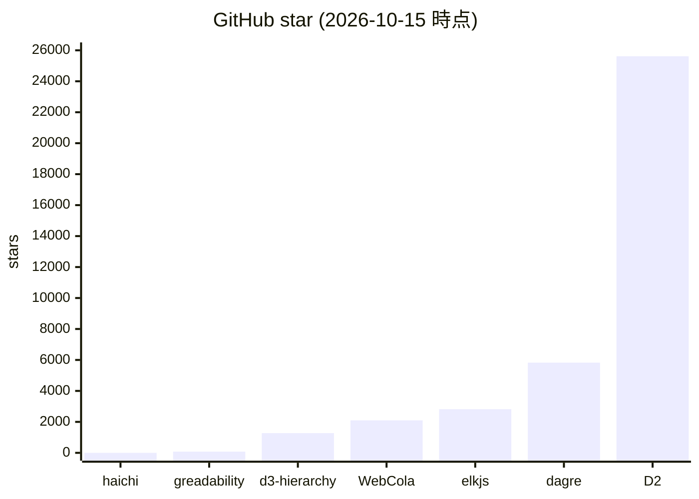
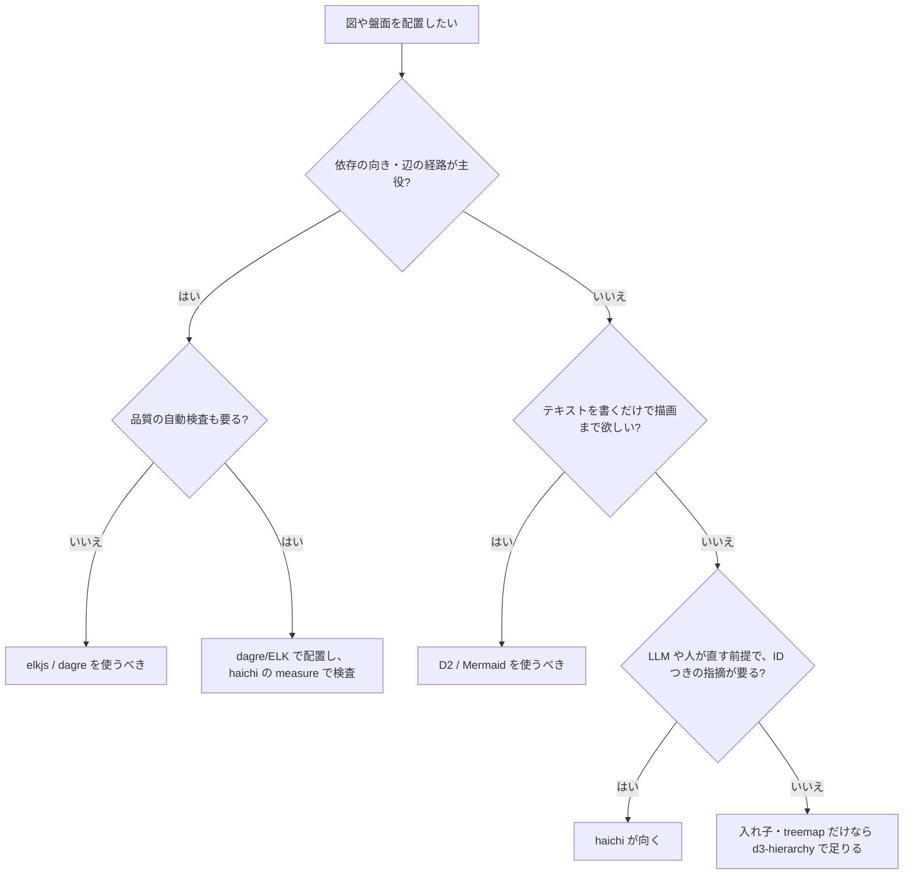

# haichi-engine 市場調査（2026-10-15）

## 0. 要約

- **立ち位置**: 配置ライブラリとして見ると d3-hierarchy 相当の小粒だが、「置いた結果が読めるかを、ID・実測値・直し方つきで返す」ライブラリは比較対象の中に無い。人や LLM が直す前提の**配置→測定→修正のループ**を、依存ゼロ・決定論的に回せるのが本体の価値。
- **最大の弱点**: **線を引けない**（layered / 辺ルーティングが無い）。`H105`（辺が図形を貫く）を報告はできても解けず、elkjs / dagre / D2 が最初から持っている部分がそっくり欠けている。あわせて、LLM が呼ぶ入口（game-engine-suite の MCP）には測定系が出ておらず、一番の強みが LLM に届いていない。
- **次の一手**: ① `measure` / `placeLabels` / `relax` を MCP に出して LLM ループに載せる → ② 直交の `route()` を入れて H105 を「解ける」ようにする → ③ npm に公開して、main の tarball 依存をやめる。

## 1. このrepoは何か

**一言**: 「どこに置くか」を決め、**置いた結果が読めるかを測って返す**純粋な幾何エンジン（`README.md`）。描画はしない。

**比較の単位** — ここを先に見極めた:

- 単体ではなく**組み合わせで価値を出す**。前段にデータを持つ側（zumen の ZIR、tetsugo の盤面、janshin の卓）、後段に描く側（SVG / three.js / canvas / DOM）がいて、haichi はその間に座る（`README.md`「立ち位置」）。
- 実際の利用者: `zumen/app/package.json` が `haichi-engine` を GitHub の main tarball で依存し、`city-districts.js` / `city-scenery.js` などで `haichi-engine/districts`・`/tree`・`/building` を import している。`game-engine-suite/mcp/engines/haichi.mjs` は MCP 経由で LLM に `pack` / `fitText` / `wrapText` / `textWidth` / `graphemes` を出している。
- 測定メッセージは「読むのは人か LLM」（README 設計契約）と明言されている。つまり実際の仕事は**「配置を作る → 機械で検査する → 人/LLM がメッセージだけ見て直す」ループ**の、配置と検査の部分。
- したがって比較対象は、(a) 同じ層の配置エンジン（elkjs / dagre / d3-hierarchy / WebCola）、(b) 配置の品質を測るライブラリ（greadability.js）、(c) ループ全体を別の形で丸ごと担うもの＝テキストを書けば配置まで済む作図言語（D2）、の3種にした。
- README は「図の配置」を前面に出しているが、コードは別の方向にも伸びている。`town.js` / `terrain.js` / `greenery.js` / `districts.js` / `tree.js` / `building.js` の計 1,492 行は、全 3,050 行（`wc -l *.js`、テストを除く）の約半分。package.json の description も「大きな構造を眺められ、覚えられるようにする」に変わっている。手続き的な町の生成は zumen の CodeCity 向けで、**図の配置とは別の市場**（watabou の TownGeneratorOS など）にあたる。本調査では図の配置を主軸に置き、町は 5.5 節で扱う。

**提供価値**: 図やゲーム盤で「データは正しいのに読めない」欠陥（文字のはみ出し、小さすぎる字、重なり、貫通）を、配置と同じ場所で測って検出する。zumen では 174 リポジトリの図から 8,842 件見つかり、0 件まで直した（README）。

**想定利用者**: 自前の可視化やゲームの盤を持つプログラマ、およびそれを呼ぶ LLM エージェント。

**到達点の客観指標（2026-10-15 に確認）**

| 指標 | 値 | 確認方法 |
|---|---|---|
| バージョン | 0.5.2 | package.json |
| テスト | **565 pass / 0 fail**（16 スイート） | `npm test` を実行。README の表記は「計 522」で古い |
| 本体 LOC | 3,050 行（10 ファイル）＋ integration 3 ファイル | `wc -l` |
| 公開 export | 67（本体 58、integration 9） | `grep -c '^export'` |
| 実行時依存 | 0 | package.json |
| 配布 | **npm 未公開**（`npm view haichi-engine` が 404）。GitHub main の tarball で取得されている | npm / zumen の package.json |
| GitHub | ★0、作成 2026-08-30、最終 push 2026-09-19 | `gh repo view` |
| 公開 URL | https://opaopa6969.github.io/haichi-engine/（ビルドなしで動くデモ） | README |

テストが多く、文書のコードを実行する検査（`docs/examples.mjs`）と、API 一覧を実装と突き合わせる検査（`docs/check-docs.mjs`）まで持っているので、成熟度は版番号の見た目より高いと読める。一方で、外から使われた実績は自作 repo 群だけで、npm にも出ていない。

## 1.5 調査の型

`engine`。生成物（座標）を作るが利用者はプログラマなので、実体はライブラリとして **API 設計**で比べる。比較対象はすべてコードが読める OSS で、5 件（elkjs / dagre / d3-hierarchy / WebCola / greadability.js）は `git clone --depth 1` して中身を読んだ。D2 は CLI ＋作図言語で、本調査ではドキュメントを読んだだけで、動かしていない。

## 2. 比較対象と選定理由

| 製品 | 何ができるか | 採用状況（2026-10-15） | ライセンス | うちとの決定的な違い | なぜ選んだか |
|---|---|---|---|---|---|
| **elkjs** | Eclipse Layout Kernel の JS 版。layered（Sugiyama）、ポート、直交ルーティング、入れ子 | ★2,818 / 最終 push 2026-10-14 / npm 0.12.0 | EPL-2.0 OR GPL-3.0-or-later | **配置と線を同時に解く**。品質の報告はしない。Java を GWT でコンパイルしたもので、配布 8.0MB | 図の自動配置で最も高機能な事実上の標準。D2 の配置エンジンの一つでもある |
| **dagre** | 有向グラフの layered 配置 | ★5,826 / 最終 push 2026-08-08 / `@dagrejs/dagre` 3.1.1 | MIT | layered と辺の折れ点を返す。品質の報告はしない | Mermaid・D2 の既定エンジンとして最も広く使われている |
| **d3-hierarchy** | pack / tree / cluster / partition / treemap | ★1,275 / 最終 push 2025-04-08 / npm 3.1.2 | ISC | うちの `pack` / `tree` / `treemap` とほぼ同じ範囲で、依存ゼロも同じ。測定は無い | **同じ層・同じ思想の最も近い先行例** |
| **WebCola** | 制約つき力学配置、重なり除去（VPSC）、格子ルーティング | ★2,099 / 最終 push 2026-04-30 / npm 3.4.0（2022-06 以降更新なし） | MIT | うちの `relax` の上位互換にあたる制約ソルバーを持つ。d3 系 4 パッケージに依存 | 重なり解消とルーティングの実装例 |
| **greadability.js** | 配置済みグラフの可読性を 4 指標（交差、交差角、角度分解能×2）で採点 | ★76 / 最終 push 2018-11-20 / npm 未公開 | BSD-3-Clause | 全体スコア 0〜1 を返すだけで、**どの要素が・どれだけ・どう直すか**は返さない。文字・ラベルを見ない | 「測る」側で唯一見つかった JS ライブラリ |
| **D2** | テキストの作図言語。配置（dagre / ELK / TALA）から描画まで | ★25,618 / 最終 push 2026-10-11 | MPL-2.0（TALA の条件はページに記載なし） | ループ全体を「LLM や人がテキストを書けば済む」形で丸ごと置き換える。読めるかの検査は無い | 組み合わせ全体と同じ仕事をする代表 |

**この分野の地図**: 図の配置は、layered 系（ELK / dagre）が寡占していて新しい OSS がほとんど出ていない。WebCola と d3-hierarchy の npm は 2022 年から版が上がっておらず、成熟して止まった分野と読める。一方「読めるかを測る」側は OSS ライブラリがほぼ空白で、greadability.js は 2018 年で止まっている。新しい動きは研究側にある。2025〜2026 年の LLM 作図の論文（Paper2SysArch、SciFig、EvoDiagram、chart-plot）は、**交差・重なり・はみ出しを幾何で数えて LLM に返すループ**を各自で作り込んでいる（検索結果の要約で確認。本文は未読）。VisEval（2024）は、視覚モデルの目視では重なりやはみ出しを十分な精度で判定できないと報告している。この需要を部品として埋める既製品は、今回の探索では見つからなかった。

## 4. 機能比較

| 機能 | 重み | haichi | elkjs | dagre | d3-hierarchy | WebCola | greadability | D2 |
|---|---|---|---|---|---|---|---|---|
| 配置後の品質検査（要素 ID ＋実測値＋直し方） | ◎ | ○（measure / measure3 の 18 規則＋Web の W201–204） | × | × | × | × | △（全体スコアのみ） | × |
| ラベル・文字幅の検査（全角、書記素、禁則） | ◎ | ○ | × | × | × | × | × | ×（描画はするが検査しない） |
| layered 配置（依存の向き） | ◎ | × | ○ | ○ | × | × | — | ○（dagre / ELK） |
| 辺ルーティング（折れ点を返す） | ◎ | ×（H105 は報告のみ） | ○（直交・ポート） | ○（折れ点） | × | △（gridrouter） | — | ○ |
| 入れ子の円詰め / treemap / tree | ○ | ○ | △（入れ子のみ） | × | ○ | × | — | △ |
| 重なり解消（既存座標の微調整） | ○ | ○（`relax`、`bounds` で領域内に収める） | × | × | × | ○（VPSC） | — | × |
| ラベル配置（周囲 8 方向、隠す判定） | ○ | ○ | △（ラベルのサイズ確保） | △（辺ラベル） | × | × | — | △ |
| 決定論的（seed） | ○ | ○ | ○ | ○ | ○ | △（初期配置に依存） | ○ | ○ |
| 実行時依存ゼロ | ○ | ○ | ○（ただし 8MB） | ×（graphlib） | ○ | ×（d3 系 4 個） | ○ | —（Go 製 CLI） |
| 3D（遮蔽・通行・距離の可読性） | △ | ○ | × | × | × | △（layout3d.ts） | × | × |
| 規模の判断（集約・認知限界の助言） | △ | ○（cognitive / cluster） | × | × | × | △（powergraph） | × | × |
| LLM が直接呼べる入口（MCP 等） | ○ | △（文字系 5 関数のみ。measure は未公開） | × | × | × | × | × | △（テキストを書かせる形） |
| npm で配布 | ○ | × | ○ | ○ | ○ | ○ | × | ○（Go のバイナリ） |
| 描画 | — | ×（契約で持たない） | × | × | × | △（d3 adaptor） | × | ○ |

**読み方**: 痛い × は「layered」と「辺ルーティング」の 2 行だけで、図の配置で ◎ のこの 2 つを両方欠いている。internals.ja.md「まだ無いもの」でも本人が最大の欠落と認めていて、zumen で H105 が 127 件出たまま解けていない。逆に、上 2 行の ◎ で ○ を持つのは haichi だけ。これが差別化の全部と言ってよい。「決定論的」「依存ゼロ」は d3-hierarchy も elkjs も満たしているので差別化にはならない。3D と認知の助言は独自だが、図の配置で選ばれる理由にはまだなっていないと読む（利用者が自作 repo だけなので）。「LLM が呼べる入口」が △ なのは、強みの測定が MCP に出ていないため。重みに比べて最も安く埋められる穴でもある。

## 4.5 コード・実装の比較

| 観点 | haichi | elkjs | dagre | d3-hierarchy | WebCola | greadability | 出典 |
|---|---|---|---|---|---|---|---|
| 公開 export | 67 | `ELK` クラス 1（`layout(graph)` が主） | 5（`graphlib`, `Graph`, `layout`, `debug`, `util`）＋型 | 15 | 16（`src/index.ts` の export 行） | 1（`greadability`） | 各 repo の入口ファイルを数えた |
| 実装規模 | 3,050 行 JS | Java → GWT 生成（JS ソースは repo に無い） | 4,064 行 TS（lib/） | 1,414 行 JS | 5,818 行 TS | 379 行 JS | `wc -l` |
| 実行時依存 | 0 | 0 | 1（`@dagrejs/graphlib`） | 0 | 4（d3-dispatch/drag/timer/shape） | 0 | package.json / `npm view` |
| テスト | 565 pass（実行） | mocha 43 ケース（`it(` 数） | 281（`it(` 数） | 83（`it(` 数） | 24（`test`/`it` 数） | 0 | haichi は `npm test` を実行、他は数えただけ |
| 配布サイズ（unpacked） | 未公開（本体 ＋ integration 186KB） | 8,046,232 B | 1,413,014 B | 136,230 B | 2,094,382 B | 未公開 | `npm view dist.unpackedSize`（2026-10-15） |
| ライセンスの制約 | MIT | EPL-2.0 / GPL-3.0 の選択（弱いコピーレフト） | MIT | ISC | MIT | BSD-3 | LICENSE / npm |
| API の形 | 関数＋素の配列 / JSON（宣言的） | JSON グラフを渡して Promise で受け取る（宣言的） | `Graph` を命令的に組み立てて `layout(g)` | `hierarchy()` で包んで、レイアウト関数を適用 | 状態を持つ `Layout` オブジェクトにメソッドを連鎖 | 関数 1 つ | README と入口ファイル |

**実際に動かした結果**（2026-10-15）:

- haichi: 2 図形を 32px 重ねて `measure` を呼ぶと `H101 a と b が 32.0px 重なっている（必要な隙間 2px）— どちらかを小さくするか relax() で押し離す` が返った。import を含めて 2 行で、**そのまま LLM に渡せる文**になっている。
- greadability.js: 4 ノード 2 辺の X 字（交差 1）を渡すと `{ crossing: -1, crossingAngle: 0.714, angularResolutionMin: 1, angularResolutionDev: 1 }` が返った。`crossing` は仕様上 0〜1 のはずが -1 になっている（小さいグラフで正規化の分母が崩れる、と推測）。返るのは全体の数値だけで、どの辺かは分からない。

**前提の違い**: elkjs / dagre は「良い配置を一度で出す」ことを目指していて、出した結果が読めるかは問わない（良いアルゴリズムなら読めるはず、という前提）。haichi は「配置は何であれ壊れうる。だから測る」を前提にしていて、他人の配置（zumen の既存座標など）にも `measure` を当てられる。この前提の違いがそのまま強みの差になっている。ただ、haichi は線を引けないので、検査の結果「H105」と言われても直す手段を自分では持たない。d3-hierarchy とは前提も規模もほぼ同じなので、`pack` / `treemap` は**差別化ではなく自前で持っているだけ**と読める。

## 5. 採用状況

star は採用の目安にすぎない。haichi は公開から 1.5 か月で宣伝も npm 公開もしていないので、0 は「負けている」ではなく「まだ外に出していない」と読む。測る側（greadability）がどれも小さいのは、需要が無いからではなく、LLM ループが出てくるまで「機械で読めるかを測って直す」場面が少なかったから、と私は見ている（推測）。

## 5.5 調査者の見立て

**本当の勝負所**は 1 点で、「LLM や下流が、メッセージだけを見て直せる検査」を部品として出せるかどうか。配置アルゴリズムの品質で elkjs と争う意味は無い。2.節の研究群は、交差・重なり・はみ出しを幾何で数える処理を各論文で毎回作り直していて、ここを部品で埋めるものが無い。haichi の `measure` はほぼそのまま答えになっている。にもかかわらず、MCP で LLM に出ているのは文字幅系の 5 関数だけで、勝負所が使われていない。

**数字に出ていないが気になること**は 2 つある。① スコープの広がり。町・地形・植生・樹形・建物で本体のほぼ半分になり、description も「眺められ覚えられる」に変わった。zumen の CodeCity の都合で伸びた部分で、「図の配置を測るライブラリ」として外から見たときに何の道具か分かりにくくなっている。② 文書と数字のずれ。「文書が嘘をつくのを機械で止めている」と書く README で、テスト数が 522（実測 565）のまま。check-docs が見ていない数字が古びている。小さいが、この repo の売りと直接ぶつかる。

**自分ならどうするか**: 「LLM ループ用の検査器」に名乗りを絞る。measure を MCP と npm に出し、線は「全部解く」のではなく「H105 を解く最小の直交ルーティング」に限って入れる。町系はサブパスのまま、README の主語から外す。

**この見立てが外れるとしたら**: (a) elkjs か dagre が交差・重なりのレポートを API に足したら、「配置と同じ場所で測る」の独自性は大きく減る。(b) 視覚モデルの判定精度が上がって、重なりやはみ出しを画像から十分な精度で拾えるようになれば、幾何の検査は「安くて速い」以上の価値を失う（VisEval の結論が覆る場合）。(c) 実際の利用者が今後も自作 repo だけなら、外向きの名乗りを絞ること自体に意味が無く、zumen 専用の内部部品として扱うのが正しい（その場合は `internal` 型で判断し直す）。

## 6. 提案（優先順）

| 順 | 提案 | 分類 | 根拠 | 最小の一手 | 効きそうな指標 |
|---|---|---|---|---|---|
| 1 | **測定系を MCP に出す**（`measure` / `placeLabels` / `relax` / `cognitive`） | 伸ばす | 4 節: 唯一の ◎○ が LLM 入口では △。`game-engine-suite/mcp/engines/haichi.mjs` が文字系 5 関数のみ | `haichi.mjs` の tools に `measure` を 1 行足し、問題 1 件のサンプルを付ける（game-engine-suite 側の変更） | LLM が作った盤面・図で H 系が 0 になるまでの往復回数 |
| 2 | **直交の `route(edges, obstacles)` を入れて H105 を解けるようにする** | 埋める | 4 節: 辺ルーティングが ◎× / zumen で H105 127 件（internals） | 格子上の A* で折れ点の列を返し、出力に `measure` をかけて H105 が減ることをテストで固定する。WebCola の `gridrouter.ts` を設計の参考にする | zumen の H105 件数 |
| 3 | **npm に公開する** | 埋める | 1 節: 未公開で、zumen は main tarball に依存。版が固定されず、利用側の再現性がない | `npm publish`（0.5.2）、zumen の依存を `^0.5.2` に変える | 利用側の lockfile が版で固定されること |
| 4 | **README の数字を check-docs の対象に入れる** | 埋める | 1 節: README 522 / 実測 565 | `check-docs.mjs` で各スイートの pass 数を合計して README と比べる | 文書の数字と実測のずれ 0 |
| 5 | layered（Sugiyama）は自作せず、**dagre の出力に measure をかける連携例**を integration に置く | 伸ばす | 4.5 節: dagre は MIT・依存 1。layered の自作は 4,000 行規模の車輪の再発明（dagre lib が 4,064 行） | `integration/dagre.mjs` で dagre の結果を shapes/edges に変換し、`measure` に渡す（依存は利用者側に持たせる） | 「既存の配置エンジン＋haichi で検査」の利用例の数 |
| 6 | **やらない: 描画（SVG / canvas アダプタ）を持つ** | やらない | 設計契約「描画しない」。D2・Mermaid と正面からぶつかり、差別化の「下流は誰でもよい」を壊す | — | — |
| 7 | **やらない: ELK 並みの汎用レイアウト（ポート制約・階層をまたぐ辺・全アルゴリズム）を追う** | やらない | elkjs は配布 8MB の Java 資産。追いつく前に「小さく読める」強みが消える。2 は H105 を解く最小に留める | — | — |
| 8 | **やらない（本体では）: 町・植生・地形をこれ以上 README の主語として広げる** | やらない | 1 節: 本体の約半分が町系で、図の配置と別の市場（TownGeneratorOS ★1,940 など）。名乗りが散る | サブパス export は残し、README の冒頭からは外す。伸ばすなら別パッケージを検討する | — |

※ 8 の internals.ja.md には「Graphviz が偉いのは配置と線を同時に解くところなので、線は別ライブラリに出さずここに入れる」とある。これは正しいと思う。ただ 5 と 7 は「layered まで自作するか」の線引きで、私は自作しない側を推す。理由は、勝負所が配置の質ではなく測定にあるから。

## 7. 選択の分岐

自分を選ばない条件が 3 つある（D・G・J）。haichi が単独で選ばれるのは I だけで、E の「他の配置エンジンと組み合わせる」が最も広い入口になりうる。提案 5 はここを狙っている。

## 8. 出典

| URL / 手段 | 参照日 | 何の根拠に使ったか |
|---|---|---|
| 自 repo `README.md` / `docs/internals.ja.md` / `package.json` | 2026-10-15 | 設計契約、立ち位置、欠落（線）、zumen・tetsugo での実測件数 |
| 自 repo で `npm test` を実行 | 2026-10-15 | 565 pass / 0 fail（16 スイート） |
| 自 repo で `measure` を実行（2 図形の重なり） | 2026-10-15 | H101 のメッセージ形式 |
| `wc -l` / `grep -c '^export'`（自 repo） | 2026-10-15 | LOC 3,050、export 67 |
| `gh repo view opaopa6969/haichi-engine` | 2026-10-15 | ★0、作成日、最終 push |
| `npm view haichi-engine` | 2026-10-15 | npm 未公開（404） |
| `/home/opa/work/zumen/app/package.json`、`zumen/app/src/city-*.js` | 2026-10-15 | 実際の利用者と依存の形（main tarball） |
| `/home/opa/work/game-workspace/game-engine-suite/mcp/engines/haichi.mjs` | 2026-10-15 | MCP に出ている関数が文字系 5 つだけ |
| `gh api repos/{kieler/elkjs, dagrejs/dagre, d3/d3-hierarchy, tgdwyer/WebCola, rpgove/greadability, terrastruct/d2, watabou/TownGeneratorOS}` | 2026-10-15 | star・最終 push・ライセンス |
| `npm view {elkjs, @dagrejs/dagre, d3-hierarchy, webcola}` | 2026-10-15 | 版、ライセンス、unpacked サイズ、依存 |
| https://github.com/kieler/elkjs（clone して読んだ） | 2026-10-15 | 構成（Java/GWT）、テスト数 |
| https://github.com/dagrejs/dagre（clone して読んだ） | 2026-10-15 | export、lib 4,064 行、テスト 281、layout のオプション |
| https://github.com/d3/d3-hierarchy（clone して読んだ） | 2026-10-15 | export 15、1,414 行、テスト 83 |
| https://github.com/tgdwyer/WebCola（clone して読んだ） | 2026-10-15 | 5,818 行、gridrouter / vpsc / layout3d の存在 |
| https://github.com/rpgove/greadability（clone して実行） | 2026-10-15 | 4 指標のみ、要素 ID なし、X 字グラフで crossing=-1 |
| https://d2lang.com/tour/layouts/ | 2026-10-15 | D2 の配置エンジンが dagre（既定）/ ELK / TALA。TALA のライセンスはページに記載なし |
| https://arxiv.org/pdf/2511.18036 （Paper2SysArch） | 2026-10-15 | 交差・重なり・はみ出しを数えて減点する評価（検索結果の要約で確認、本文未読） |
| https://arxiv.org/pdf/2601.04390 （SciFig） | 2026-10-15 | 重なり・読めないラベルを検査して修正プロンプトに戻すループ（同上） |
| https://arxiv.org/pdf/2604.09568 （EvoDiagram） | 2026-10-15 | 折返しを模擬してから配置するツール呼び出し（同上） |
| https://arxiv.org/pdf/2606.09174 （chart-plot） | 2026-10-15 | 実測値つきの構造化診断を LLM に返す（同上） |
| https://arxiv.org/pdf/2407.00981 （VisEval） | 2026-10-15 | 視覚モデルの重なり・はみ出し判定が不正確（同上） |

## 9. 前回からの差分

前回の調査は無い（`docs/market/` が存在せず、issue-hub の `type:market` にも haichi-engine の issue が無いことを 2026-10-15 に確認）。再調査の指示を受けたが、実質はこれが初回。次回はこの文書を基準に、6 節の提案 1〜4 がどうなったかと、review_trigger の (a) elkjs / dagre の品質レポート対応を見る。
